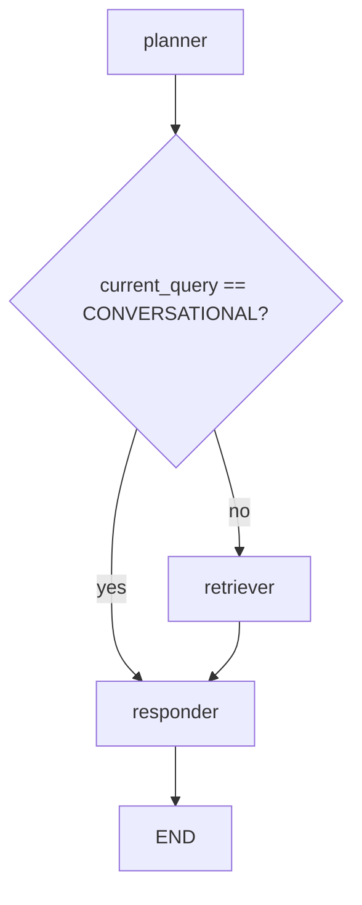

# Agents

## Purpose

A separate LangGraph agent that plans, optionally retrieves, and answers. It is
exposed by the API at `/api/agent` and by the legacy single-tenant app
`src/main.py` at `/query` and `/graph`.

This path is **not** the RAG pipeline behind `/api/chat`. It has its own graph,
its own Qdrant search helper, its own FlashRank reranker and its own in-process
memory. It does not use `RAGPipeline`, the SQLite chat store or the Presidio
scrubber.

## Agent graph/state machine



Compiled in `src/agents/graph.py`:

- `StateGraph(AgentState)` with nodes `planner`, `retriever`, `responder`.
- Entry point: `planner`.
- Conditional edge from `planner`: `route_planner()` returns `responder` when
  `current_query == "CONVERSATIONAL"`, otherwise `retriever`.
- `retriever -> responder -> END`.
- `MemorySaver` checkpointer; `rag_agent = workflow.compile(checkpointer=checkpointer)`.

### State

`src/agents/state.py`:

| Field | Type | Semantics |
|---|---|---|
| `messages` | `Annotated[list[dict], operator.add]` | Appended, not replaced |
| `current_query` | `str` | Planner output: `CONVERSATIONAL` or a search query |
| `documents` | `list[str]` | Formatted `CONTENT: ...` blocks from the retriever |
| `plan` | `list[str]` | Human-readable steps for the API response |
| `status` | `str` | Current status string |
| `final_answer` | `str` | Responder output |

### Node behavior

- `planner_node()` (`src/agents/nodes/planner.py`) builds a prompt from the full
  message history and the latest message, calls `get_langchain_llm(feature="planner")`,
  and returns either `CONVERSATIONAL` or a refined search query.
- `retrieve_node()` (`src/agents/nodes/retriever.py`) calls
  `search_enterprise_knowledge(query, limit=15, user_id="dev")`, then
  `rerank_documents(query, contents, top_n=5)`, and formats the survivors as
  `CONTENT: <text>`.
- `generate_node()` (`src/agents/nodes/responder.py`) builds a prompt from the
  conversation history and the retrieved context (capped at 25,000 chars), calls
  `llm_client.chat.completions.create(..., temperature=0.1)`, passes the result
  through `display_text()` and `guard_output()`, and returns `final_answer`.

## Tools & contracts

### `search_enterprise_knowledge`

`src/services/retrieval/qdrant_service.py`:

```python
search_enterprise_knowledge(
    query: str,
    limit: int = 8,
    *,
    user_id: str | None = None,
    collection_name: str | None = None,
    document_id: str | None = None,
) -> list[dict]
```

- Resolves the collection as `collection_name`, else
  `<COLLECTION_NAME>__<user_id>`, else `settings.QDRANT_COLLECTION`.
- Embeds the query with `embed_query()` and calls `QdrantVectorDB.search()`.
- Returns rows with `content`, `source`, `document_id`, `page`, `score`.
- The retriever node calls it with `limit=15, user_id="dev"`, so the agent always
  reads the `dev` tenant collection.

### `rerank_documents`

`src/services/retrieval/ranking_service.py`:

```python
rerank_documents(query: str, documents: list[str], top_n: int = 5) -> list[str]
```

- Lazily loads a local FlashRank ONNX cross-encoder (`cache_dir="/tmp/flashrank"`
  when available).
- Returns the top `n` texts.
- On any failure, returns `documents[:top_n]` so the agent still answers.

### LLM clients

`src/gateway/client.py`:

- `llm_client` — lazy proxy. Uses `OpenRouterLLMClient` when
  `OPENROUTER_API_KEY` is set; otherwise `GroqLLMClient` when `GROQ_API_KEY` is
  set; otherwise raises on first use.
- `OpenRouterLLMClient` sends `models: [OPENROUTER_MODEL, OPENROUTER_FALLBACK_MODEL]`
  with `route: "fallback"` and optional `X-OpenRouter-Cache` headers.
- `GroqLLMClient` uses `GROQ_MODEL` and falls back to
  `GROQ_FALLBACK_API_KEY`/`GROQ_FALLBACK_MODEL` on failure.
- `get_langchain_llm(feature)` returns a LangChain `Runnable` for the planner:
  OpenRouter `ChatOpenAI` with model fallback, or Groq `ChatGroq` with optional
  `.with_fallbacks([...])`.
- `get_guard_llm()` exists for a NeMo-style guard but is not used by
  `src/guardrails/rails.py`.

### Agent API contract

`src/api/routers/agent.py`:

- `GET /api/agent` → `AgentGraphOut` with `nodes`, `edges`, `mermaid`,
  `entry_point`, `checkpointer`, `guardrails_ready`, `corpus`.
- `POST /api/agent/query` with `AgentQuery` (`q`, `thread_id`) → `AgentResponse`
  (`question`, `answer`, `thought_process`, `status`, `sources`, `guardrails`).

## Prompts & guardrails

### Prompts

The planner and responder prompts are inline f-strings in
`src/agents/nodes/planner.py` and `src/agents/nodes/responder.py`. The agent does
not use `config/prompts.py`.

### Llama Guard

`src/guardrails/rails.py` + `src/guardrails/guard_model.py`:

- `guard(message)` — input gate. Classifies the question with Llama Guard and
  returns `(blocked, refusal)`.
- `guard_output(text)` — output gate. Classifies the generated answer and returns
  `(blocked, replacement)`.
- Model: `ANEXUS_GUARD_MODEL` (default `meta-llama/llama-guard-4-12b`) served
  through OpenRouter; `OPENROUTER_API_KEY` is required.
- Hazard codes `S1`–`S13` are defined in `HAZARDS`.
- `ANEXUS_GUARD_OUTPUT_IGNORE_CATEGORIES` defaults to `S6,S7` (specialized advice,
  privacy); input ignores nothing by default.
- Fail-closed: a guard call failure returns unsafe unless
  `ANEXUS_GUARD_FAIL_OPEN=true`.
- `ANEXUS_GUARD_MAX_CHARS = 4000` truncates the classified text.
- Classifications are cached in-process (`lru_cache(maxsize=512)`).

Wiring:

- `POST /api/agent/query` calls `_ensure_rails()` (which calls
  `initialize_rails()`) and then `guard(body.q)` before running the graph. If the
  guard is unavailable, the graph still runs and the response reports
  `guardrails="unavailable"`.
- `generate_node()` calls `guard_output(content)` and replaces a blocked answer.
- `src/main.py` calls `guard(q)` before `rag_agent.invoke()`.

### Legacy NeMo rules

`src/guardrails/colang_rules.py` contains Colang intent/flow definitions and
`RAIL_INDICATORS`, but it is not imported by `rails.py` and `initialize_rails()`
does not build a NeMo rails engine. Treat it as legacy reference material.

### PII

The agent path does not call `PresidioScrubber` or `build_llm_inputs()`. Retrieved
document text goes to the provider unredacted; only the final answer passes
through `display_text()`. The PII gate described in the root README applies to
`RAGPipeline` (`/api/chat`), not to `/api/agent`.

## Memory & state

- `MemorySaver` is created in `src/agents/graph.py` and passed to `compile()`.
- Memory is keyed by `config={"configurable": {"thread_id": ...}}`.
- It is in-process only: restarting the API loses agent threads.
- `messages` accumulates across turns; `plan`, `status` and `documents` are
  overwritten by each node.
- The API does not persist agent turns. `POST /api/agent/query` returns the
  response but does not write to `ChatStore`; `thread_id` defaults to
  `"default_user"`.

## Error handling & fallbacks

| Failure | Behavior |
|---|---|
| Input guard blocks | API returns `status="Blocked by guardrails."`, `guardrails="blocked"`, no graph run |
| Guard unavailable | `initialize_rails()` logs; graph runs; `guardrails="unavailable"` |
| Planner LLM fails | Exception propagates out of `rag_agent.invoke()`; API catches it and returns `status="error"` |
| Retriever Qdrant fails | Exception propagates; API returns `status="error"` |
| FlashRank rerank fails | `rerank_documents()` returns the original order |
| Responder LLM fails | `generate_node()` logs and re-raises; API returns `status="error"` |
| Output guard blocks | Answer is replaced with `OUTPUT_REFUSAL`; `status="Blocked by output guard."` |
| OpenRouter model failure | `models` fallback list and `route: "fallback"` |
| Groq primary failure | Secondary key/model when `GROQ_FALLBACK_API_KEY` is set |

The legacy `src/main.py` catches exceptions around `rag_agent.invoke()` and returns
a JSON error body with `status="error"` instead of raising.

## How to run

API path:

```bash
uvicorn src.api.main:app --reload --port 8000
```

```bash
curl http://localhost:8000/api/agent
curl -X POST http://localhost:8000/api/agent/query \
  -H "Content-Type: application/json" \
  -d '{"q": "What is the loan amount?", "thread_id": "t1"}'
```

Legacy single-tenant app:

```bash
uvicorn src.main:app --reload --port 8000
curl -X POST http://localhost:8000/query \
  -H "Content-Type: application/json" \
  -d '{"q": "What is the loan amount?", "thread_id": "t1"}'
curl http://localhost:8000/graph   # Mermaid PNG
```

Required configuration:

| Variable | Purpose |
|---|---|
| `OPENROUTER_API_KEY` | Preferred gateway; also required for Llama Guard |
| `GROQ_API_KEY` | Direct Groq path |
| `GROQ_FALLBACK_API_KEY`, `GROQ_FALLBACK_MODEL` | Secondary Groq |
| `OPENROUTER_MODEL`, `OPENROUTER_FALLBACK_MODEL` | Gateway models |
| `ANEXUS_GUARD_ENABLED` | `false` disables both guard directions |
| `ANEXUS_GUARD_MODEL` | Llama Guard model id |
| `ANEXUS_GUARD_FAIL_OPEN` | `true` allows through on guard failure |
| `ANEXUS_QDRANT_URL`, `ANEXUS_QDRANT_API_KEY` | Agent retrieval backend |

Relevant tests: `tests/test_api.py` (agent routes with a stub graph),
`tests/test_guardrails.py`.

## Known limits

- `retrieve_node()` hardcodes `user_id="dev"`; agent retrieval always reads the
  `dev` tenant collection, regardless of the API's `X-User-Id`.
- No PII scrubber on the agent path; retrieved text is sent to the provider
  unredacted.
- No citation objects are persisted or returned as structured data; `sources` is a
  list of formatted `CONTENT: ...` strings.
- No token streaming; the responder waits for the full completion.
- `MemorySaver` is in-process and is not shared across workers or restarts.
- The agent uses a separate retrieval stack from `RAGPipeline`; improvements to
  hybrid retrieval, RRF, multi-query and document scoping do not apply here.
- The agent corpus is whatever is in the `dev` collection; it does not use the
  document registry or per-document scope.
- Guard availability depends on `OPENROUTER_API_KEY`; without it the agent runs
  without a safety gate and says so.
- The planner and retriever log raw query text, which conflicts with the
  observability privacy contract (see `docs/OBSERVABILITY.md`).
- `src/main.py` is a legacy duplicate of the agent API and configures Logfire
  separately from `src/observability.py`.