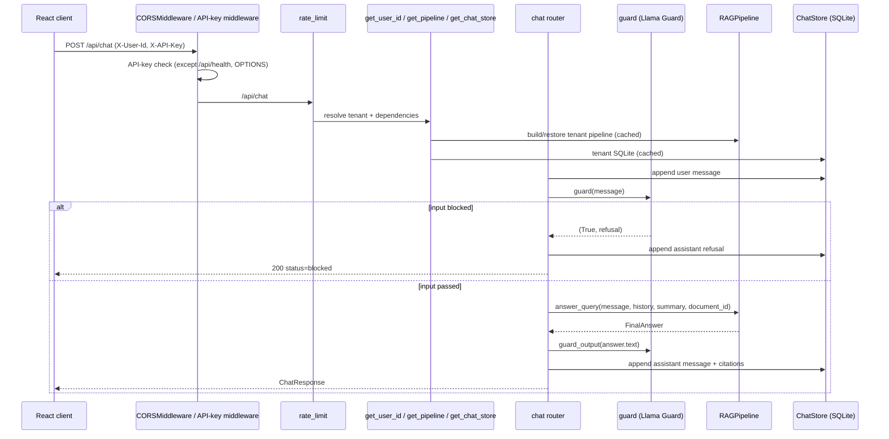

# API

## Purpose

FastAPI application that serves the React client and the JSON API. It exposes the
RAG pipeline, per-tenant conversations, the document library, the LangGraph agent
and evaluation artifacts.

The app is created by `create_app()` in `src/api/main.py` and served by
`uvicorn src.api.main:app` or `python -m src.api`.

## Request lifecycle



`POST /api/chat/stream` follows the same preparation but returns
`text/event-stream` with `meta`, `delta`, `guard` (when blocked) and
`done`/`error` events.

## Endpoints & schemas

All routes are mounted under `/api` except the SPA fallback and the root route.

| Method | Path | Request | Response | Notes |
|---|---|---|---|---|
| `GET` | `/api/health` | — | `HealthOut` | No pipeline build |
| `POST` | `/api/chat` | `ChatRequest` | `ChatResponse` | Persists both messages |
| `POST` | `/api/chat/stream` | `ChatRequest` | SSE | `meta`, `delta`, `guard`, `done`, `error` |
| `GET` | `/api/conversations` | `limit` query (1–200, default 50) | `list[ConversationOut]` | |
| `POST` | `/api/conversations` | `ConversationCreate` | `ConversationOut` | 201 |
| `GET` | `/api/conversations/{id}` | — | `ConversationDetail` | Includes messages |
| `PATCH` | `/api/conversations/{id}` | `ConversationRename` | `ConversationOut` | |
| `DELETE` | `/api/conversations/{id}` | — | 204 | Cascades messages |
| `POST` | `/api/messages/{id}/feedback` | `FeedbackIn` | `MessageOut` | `up`, `down` or `null` |
| `GET` | `/api/documents` | — | `list[DocumentOut]` | Tenant corpus |
| `GET` | `/api/documents/{id}` | — | `DocumentOut` | |
| `GET` | `/api/documents/{id}/file` | — | file | Inline original; `X-Content-Type-Options: nosniff` |
| `POST` | `/api/documents` | multipart `file` | `IngestResponse` | 201; runs ingestion in a thread pool |
| `DELETE` | `/api/documents/{id}` | — | 204 | Removes chunks, registry row and managed source |
| `GET` | `/api/agent` | — | `AgentGraphOut` | Graph introspection |
| `POST` | `/api/agent/query` | `AgentQuery` | `AgentResponse` | Separate LangGraph path |
| `GET` | `/api/eval/runs` | — | `list[EvalRunSummary]` | Reads `evaluation/results*.json` |
| `GET` | `/api/eval/runs/{name}` | — | `EvalRun` | Name must match `results*.json` |
| `GET` | `/` | — | service/version/docs/health | `include_in_schema=False` |
| `GET` | `/docs`, `/redoc`, `/openapi.json` | — | OpenAPI UI/schema | FastAPI defaults |
| `GET` | `/{full_path:path}` | — | `index.html` or file | Only when `frontend/dist` exists |

### Key schemas

`src/api/schemas.py`:

- `ChatRequest`: `message` (1–4000 chars), `conversation_id?`, `document_id?`.
- `ChatResponse`: `conversation_id`, `user_message_id`, `assistant_message_id`,
  `answer`, `citations`, `provider`, `model`, `latency_s`, `intent`, `status`
  (`answered` | `no_context` | `blocked`), `guard` (`passed` | `blocked`),
  `pii_redactions`.
- `CitationOut`: `page_number`, `score`, `snippet`, `document_id`, `filename`.
- `ConversationCreate`: `title`, `document_id?`, `document_name?`.
- `ConversationRename`: `title` (1–200).
- `ConversationOut`: `id`, `title`, `document_id?`, `document_name?`, `summary`,
  `created_at`, `updated_at`, `message_count`.
- `ConversationDetail`: `ConversationOut` + `messages`.
- `MessageOut`: `id`, `role`, `content`, `citations?`, `feedback?`, `created_at`.
- `FeedbackIn`: `value` (`up` | `down` | `null`).
- `DocumentOut`: `id`, `filename`, `pages`, `chunks`, `vectors`, `duration_s`,
  `content_hash?`, `file_available`, `created_at`.
- `IngestResponse`: `document_id`, `filename`, `pages`, `chunks`, `duration_s`,
  `vectors_added`, `content_hash?`, `pages_empty_dropped`, `pages_ocr`,
  `pages_overcleaned`, `chunks_dropped_short`, `boilerplate_lines_removed`,
  `chunks_mean_chars`, `chunks_median_chars`, `chunks_max_chars`.
- `HealthOut`: `status`, `service`, `environment`, `user_id`, `collection`,
  `qdrant_configured`.
- `AgentQuery`: `q` (1–4000), `thread_id` (default `default_user`).
- `AgentResponse`: `question`, `answer`, `thought_process`, `status`, `sources`,
  `guardrails` (`passed` | `blocked` | `unavailable`).
- `AgentGraphOut`: `nodes`, `edges`, `mermaid`, `entry_point`, `checkpointer`,
  `guardrails_ready`, `corpus`.
- `EvalRunSummary` / `EvalRun`: `name`, `modified_at`, `items`, `summary`,
  `rows`.

## Auth

### Tenant identity

`get_user_id()` in `src/api/dependencies.py` reads the `X-User-Id` header:

- Must match `^[A-Za-z0-9_-]{1,64}$`; otherwise `400`.
- Defaults to `ANEXUS_DEV_USER_ID` (normally `dev`) when absent.

There is **no authentication** in this build. The header is trusted as-is; any
client can claim any tenant. Put an authenticating proxy or OIDC in front of the
API before exposing it beyond localhost.

### Per-tenant isolation

`src/auth/tenancy.py`:

- Qdrant collection: `<COLLECTION_NAME>__<user_id>`.
- SQLite database: `data/users/<user_id>/app.sqlite3` (documents + conversations).
- Uploaded originals: `data/users/<user_id>/documents/`.
- Upload temp files: `data/users/<user_id>/uploads/`.

The pipeline, chat store and caches are cached per tenant for the life of the
process. Heavy models (embedder, cross-encoder, spaCy) are process-shared.

### API key

When `ANEXUS_API_KEY` or `FRONTEND_API_KEY` is set, a middleware in
`create_app()` requires `X-API-Key` on every `/api` route except `/api/health`
and `OPTIONS` requests. A missing or wrong key returns `401`.

### CORS

`CORSMiddleware` uses `ANEXUS_CORS_ORIGINS` (comma-separated). Defaults include
Vite `5173`/`4173`, `3000` and `8000` on localhost/127.0.0.1.
`allow_credentials` is false when the origin list contains `*`.

### Rate limit

`_SlidingWindowLimiter` in `src/api/dependencies.py` applies to every router that
declares `Depends(rate_limit)` (chat, conversations, messages, documents, agent,
eval). It is a per-client-IP sliding window of
`ANEXUS_API_RATE_LIMIT = 120` requests per 60 s. `/api/health` is not limited.
Exceeding it returns `429` with `Retry-After: 60`.

### Modules not wired

`src/auth/user_store.py` (accounts + encrypted credentials) and
`src/auth/secrets_vault.py` (Fernet vault) exist but are not imported by any API
router. There is no login, session, role or BYOK key-management endpoint in this
build. `src/auth/tenancy.py` is the only auth module used by the API.

## Error model

| Status | When |
|---|---|
| `400` | Invalid `X-User-Id`; empty question in `answer_query` validation; unsupported file type or no text extracted during ingestion |
| `401` | Missing/invalid `X-API-Key` when the API key is configured |
| `404` | Conversation, document, message or eval run not found; original source file unavailable |
| `409` | Duplicate document content and `ANEXUS_DEDUP_ACTION=skip` |
| `413` | Upload exceeds `ANEXUS_MAX_UPLOAD_MB` |
| `422` | Pydantic request validation (for example empty `q`) |
| `429` | Rate limit exceeded; includes `Retry-After: 60` |
| `500` | Ingestion failed after parsing, or source retention failed (rolls back the document) |
| `502` | RAG pipeline failed during chat, or stream preparation failed |
| `503` | Pipeline could not be built for the tenant |
| `204` | Successful delete |

Chat persistence order:

1. Resolve/create the conversation.
2. Append the user message.
3. Run the input guard.
4. Generate the answer.
5. Run the output guard.
6. Append the assistant message with citations.

If generation fails after step 2, the user message remains stored and no assistant
message is added; the client receives `502`. In streaming mode, once the response
has started, failures are reported as an `error` SSE event rather than an HTTP
status.

The eval router only reads files matching `^results[A-Za-z0-9_.-]*\.json$` inside
`evaluation/`; other names return `400`/`404`.

## Config

### API settings (`src/api/config.py`)

| Variable | Default | Effect |
|---|---|---|
| `ANEXUS_ENV` | `development` | Reported by `/api/health` |
| `ANEXUS_API_KEY` / `FRONTEND_API_KEY` | unset | Enables the `X-API-Key` middleware |
| `ANEXUS_CORS_ORIGINS` | localhost 5173/4173/3000/8000 | Allowed browser origins |
| `ANEXUS_API_RATE_LIMIT` | `120` | Requests per minute per client IP |
| `ANEXUS_MAX_UPLOAD_MB` | `50` | Multipart upload cap |

### Server (`src/api/__main__.py`)

| Variable | Default |
|---|---|
| `ANEXUS_API_HOST` | `127.0.0.1` |
| `ANEXUS_API_PORT` | `8000` |
| `ANEXUS_API_RELOAD` | `0` |
| `ANEXUS_API_LOG_LEVEL` | `info` |

### Pipeline / platform settings used by the API

| Variable | Default | Effect |
|---|---|---|
| `ANEXUS_QDRANT_URL` | unset | Qdrant endpoint |
| `ANEXUS_QDRANT_API_KEY` | unset | Qdrant key |
| `ANEXUS_QDRANT_COLLECTION` | `anexus_rag_collection` | Base collection name |
| `ANEXUS_DEV_USER_ID` | `dev` | Tenant used when `X-User-Id` is absent |
| `ANEXUS_API_WARMUP` | `0` | Build the default tenant's pipeline in a background thread at startup |
| `ANEXUS_GUARD_ENABLED` | `true` | Input/output Llama Guard gate |
| `ANEXUS_GUARD_MODEL` | `meta-llama/llama-guard-4-12b` | Guard model |
| `ANEXUS_GUARD_FAIL_OPEN` | `false` | Block on guard failure |
| `ANEXUS_CACHE_ENABLED` | `1` | Exact-match response cache |
| `ANEXUS_REDIS_URL` | unset | Optional shared cache L2 |
| `ANEXUS_STREAMING_ENABLED` | `1` | SSE token streaming |
| `LOGFIRE_TOKEN` | unset | Traces/logs export |

`.env` is loaded by `config/settings.py` and `src/api/config.py` before settings
are read; real environment variables win.

## How to run & test

Run the API:

```bash
uvicorn src.api.main:app --reload --port 8000
# or
python -m src.api
```

OpenAPI docs: `http://localhost:8000/docs`.

Serve the built React client from the same process (optional):

```bash
cd frontend
npm install
npm run build
cd ..
uvicorn src.api.main:app --port 8000
```

When `frontend/dist/index.html` exists, the API mounts `/assets` and falls back to
`index.html` for client routes. Without a build it serves JSON only.

Examples:

```bash
curl -H "X-User-Id: dev" http://localhost:8000/api/health

curl -H "X-User-Id: dev" -H "Content-Type: application/json" \
  -d '{"message": "What is the loan amount?"}' \
  http://localhost:8000/api/chat

curl -H "X-User-Id: dev" \
  -F "file=@Synthetic_Mortgage_Loan_File_TEST_01.pdf" \
  http://localhost:8000/api/documents
```

With the API key enabled:

```bash
curl -H "X-API-Key: $ANEXUS_API_KEY" -H "X-User-Id: dev" \
  http://localhost:8000/api/documents
```

Tests:

```bash
python -m pytest -q tests/test_api.py
```

`tests/test_api.py` replaces the pipeline with an in-test double and uses a real
SQLite `ChatStore` in `tmp_path`; it does not require Qdrant or provider keys.
The full offline suite is `python -m pytest -q` with `SIMULATE_LLM=true`.

Related documentation:

- `docs/INGESTION.md`
- `docs/RETRIEVAL.md`
- `docs/AGENT.md`
- `docs/EVALUATION.md`
- `docs/OBSERVABILITY.md`