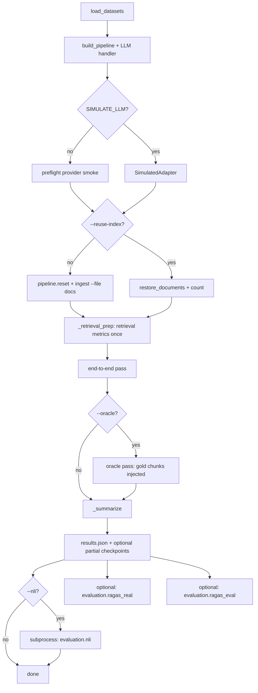

# Evaluation

## Purpose

Score the RAG pipeline on two 50-question golden datasets, separating retrieval
quality from generation quality, with optional real-provider, LLM-judge, NLI and
closed-book hallucination passes.

The harness is `evaluation/run_eval.py`. It builds the real pipeline
(`src/pipeline_factory.build_pipeline`), ingests the source PDFs into Qdrant, runs
the golden questions through `RAGPipeline.answer_query()`, and writes a JSON report
with per-row and summary metrics. It can run fully offline with the simulated LLM
(`SIMULATE_LLM=true`) or against configured providers.

## What is evaluated

| Area | Metrics |
|---|---|
| Retrieval ranking | HitRate@K, true Recall@K, Precision@K, MRR@K, nDCG@K |
| Context quality | Context precision (average precision), context recall (gold answer points present in the retrieved context) |
| Answer correctness | Accuracy against curated literal answer points; answered rate; no-context rate |
| Grounding | Claim-level token-F1 of each answer sentence against the retrieved context (`groundedness`, `ungrounded_fraction`) |
| Answer relevance | Embedding cosine between the answer and the golden answer |
| Citations | `citation_support_rate` (cited `(doc, page)` pairs that were in the top-k), `citation_coverage` (answers with at least one citation) |
| Safety | `pii_leak_rate` (answers matching a mirrored PII pattern) |
| Provider behavior | Provider used, fallback chain, fallback rate, median end-to-end latency |
| Cost | Calls, prompt/completion/total tokens, USD (`evaluation/cost.py`) |
| Claim verification (optional) | NLI entailment/contradiction fractions |
| Semantic judge (optional) | RAGAS faithfulness, answer relevancy/correctness, context precision/recall, response groundedness |
| Closed-book baseline | TruthfulQA MC1 accuracy |

Retrieval metrics are computed with generation disabled, from the reranked list.
Answer metrics are computed per row and aggregated by category and provider.

## Datasets & golden sets

Default datasets (`DEFAULT_DATASETS` in `run_eval.py`):

| Dataset | Source document | Shape |
|---|---|---|
| `evaluation/golden_dataset_01.json` | `Synthetic_Mortgage_Loan_File_TEST_01.pdf` | Plain JSON list |
| `evaluation/golden_dataset_02.json` | `Synthetic_Mortgage_Loan_File_TEST_02.pdf` | `{"questions": [...]}` wrapper |

Each item carries:

- `id`, `category`, `difficulty`, `question`;
- `source_pages` — the gold page numbers in the mapped source document;
- `expected_answer` and/or `acceptable_answer_points`;
- `required_fact_groups` (dataset 02) — a list of OR-groups where every group must
  match at least one variant (conjunctive grading);
- `source_file` is injected by `load_datasets()` from the dataset-to-document map.

Question ids are re-prefixed per file (`d01_q001`, `d02_q001`) so both sets can
share one corpus. Category aliases (`direct`, `definition`, `numerical`) are
normalized to the canonical vocabulary.

`--dataset PATH=SOURCE_FILE` overrides the defaults; `PATH` alone is accepted only
when the path is a known default. `--limit N` scores only the first N items.

## Metrics & thresholds

### Retrieval

| Metric | Definition |
|---|---|
| `hit_at_k` | 1.0 if any gold page is in the top `k` |
| `recall_at_k` | Hits / number of gold pages (true recall) |
| `precision_at_k` | Hits / `k` |
| `mrr_at_k` | Reciprocal rank of the first hit |
| `ndcg_at_k` | Binary-gain nDCG over the ranked list |
| `context_precision` | Average precision over relevant hits |
| `context_recall` | Fraction of gold answer points present in the scrubbed top-k context |

`k` defaults to `TOP_K_RERANK = 5` (`--k`).

### Generation

| Metric | Definition |
|---|---|
| `answer_accuracy` | Correct rows / rows |
| `answered_rate` | Rows whose answer is not the no-context response |
| `no_context_rate` | Rows that returned the no-context response |
| `groundedness` | Mean claim-level token-F1 against the retrieved context |
| `ungrounded_fraction` | Mean fraction of claims below `UNGROUNDED_THRESHOLD = 0.3` |
| `answer_relevance` | Embedding cosine vs the golden answer (`None` when no expected answer) |
| `citation_support_rate` | Supported citations / all model-emitted citations |
| `citation_coverage` | Rows with at least one citation / answered rows |
| `pii_leak_rate` | Rows with a mirrored PII pattern / rows |
| `fallback_rate` | Rows where a fallback provider was used |
| `median_e2e_s` | Median answer latency |

### NLI

`nli_entailed_fraction` and `nli_contradiction_fraction` use a local
`cross-encoder/nli-deberta-v3-base` with a probability threshold of `0.5`
(`--threshold`). A claim is entailed when its entailment probability is at least
the threshold and at least its contradiction probability.

### Thresholds and gating

The code defines only the metric-internal thresholds above
(`UNGROUNDED_THRESHOLD = 0.3`, NLI `0.5`). It does **not** define pass/fail
cut-offs for accuracy, recall, groundedness or PII leak. CI runs the harness and
uploads the report; a low score does not fail the job. Any numeric gate would be a
policy decision outside this code.

## Eval flow diagram



The oracle pass uses `_bypass_retrieval()`: it temporarily replaces
`pipeline.expander.expand`, `pipeline.retriever.hybrid_retrieve` and
`multi_query_retrieve` with the item's gold chunks, then restores them. Query
expansion is disabled for the oracle so no paraphrase can change the context. The
reranker and PII scrubber still run.

## Judge/LLM-as-judge setup

### RAGAS (real judge)

`evaluation/ragas_real.py` re-scores a finished `results.json` with RAGAS 0.4.3.

- Judge: `--judge groq` (default, `openai/gpt-oss-120b`) or `--judge nvidia`.
  The judge is a `LangchainLLMWrapper` over `ChatOpenAI`, because RAGAS's
  `llm_factory` returns an `InstructorLLM` the legacy metrics cannot call.
- Metrics: `faithfulness`, `answer_relevancy`, `answer_correctness`,
  `context_precision`, `context_recall`, `response_groundedness`.
  `answer_relevancy`, `answer_correctness` and `semantic_similarity` also need an
  embedding model, built from `EMBEDDING_MODEL_NAME` (`BAAI/bge-large-en`).
- Only legacy `ragas.metrics` classes pass `evaluate()`'s `isinstance` check; the
  modern `ragas.metrics.collections.*` classes are rejected.
  `evaluation/ragas_compat.py` installs an import hook for two missing
  `langchain_community` VertexAI names so `import ragas` works on the installed
  LangChain 1.x stack.
- Rows are joined to golden `expected_answer` by id; rows without a reference,
  answer or contexts are skipped.
- `--resume` merges into the existing report and scores only rows missing one of
  the requested metric columns. `--timeout-s` defaults to 600 s because
  multi-call metrics exceed RAGAS's 180 s default on free tiers.
- Output defaults to `evaluation/ragas_real.json`.

### Offline grounding report

`evaluation/ragas_eval.py` does **not** use an LLM judge. It recomputes
`metrics.groundedness` from a saved `results.json` and writes
`evaluation/ragas_report.json`. It is the standalone, offline stand-in for RAGAS
faithfulness.

### NLI

`evaluation/nli.py` is a local, offline claim verifier. Each answer is split into
claims; each claim is paired with every retrieved context snippet; the
cross-encoder predicts entailment/contradiction. It adds `nli_claim_count`,
`nli_entailed_fraction` and `nli_contradiction_fraction` to each row and to the
summary. It runs in a separate process (`--nli` in `run_eval`, or standalone)
because the ~700 MB model must not sit beside the embedder on a 4 GB machine.

### TruthfulQA

`evaluation/benchmarks/truthfulqa.py` is a closed-book MC1 benchmark: no documents,
no retrieval, no pipeline. The bare generator picks a letter; scoring is exact
match, judge-free and deterministic (seeded shuffle). It is the hallucination
baseline next to the RAG numbers. The dataset is cached at
`evaluation/data/truthfulqa_generation.json` after `--download-only`.

## Regression gating/CI

`.github/workflows/rag-eval.yml` — automatic gate:

- `test` job: Python 3.12, installs `requirements.txt`, `tesseract-ocr` and
  `en_core_web_sm`, runs `python -m pytest -q` with `SIMULATE_LLM: "true"`.
- `eval` job: starts an ephemeral `qdrant/qdrant` service on `localhost:6333`,
  sets `ANEXUS_QDRANT_URL`, caches Hugging Face weights, then runs
  `python -m evaluation.run_eval --file TEST_01.pdf --file TEST_02.pdf --out
  evaluation/results.json` with `SIMULATE_LLM: "true"`.
- Uploads `evaluation/results.json` as the `rag-eval-results` artifact.
- Triggers: push to `main`, `nazish-development`, `ashfaque-development`; pull
  requests to `main`.

`.github/workflows/rag-eval-real.yml` — manual only (`workflow_dispatch`):

- Inputs: `limit`, `provider`, `oracle`, `nli`, `max_cost_usd`.
- Installs `requirements.txt` + `requirements-eval.txt` and spaCy.
- Runs `evaluation.provider_smoke` first, then `run_eval --resume
  --min-interval-s 1 ...` with repository secrets `NVIDIA_API_KEY`,
  `GROQ_API_KEY` and optional `GEMINI_API_KEY`.
- Optional `evaluation.nli --results evaluation/results.json` post-scorer.
- Uploads `evaluation/results.json`.

Neither workflow fails on a metric value. They fail on pytest failures, missing
providers, or an eval command error.

## How to run

Offline end-to-end and retrieval metrics:

```bash
python -m evaluation.run_eval \
  --file Synthetic_Mortgage_Loan_File_TEST_01.pdf \
  --file Synthetic_Mortgage_Loan_File_TEST_02.pdf
```

Add the oracle pass (gold pages injected, retrieval bypassed):

```bash
python -m evaluation.run_eval \
  --file Synthetic_Mortgage_Loan_File_TEST_01.pdf \
  --file Synthetic_Mortgage_Loan_File_TEST_02.pdf --oracle
```

Reuse an existing index (skip reset + ingest):

```bash
python -m evaluation.run_eval --reuse-index --oracle
```

Real providers (keys in `.env`):

```bash
python -m evaluation.provider_smoke
python -m evaluation.run_eval --resume --oracle --min-interval-s 1 \
  --max-cost-usd 0 \
  --file Synthetic_Mortgage_Loan_File_TEST_01.pdf \
  --file Synthetic_Mortgage_Loan_File_TEST_02.pdf
```

Offline groundedness report from a saved run:

```bash
python -m evaluation.ragas_eval --input evaluation/results.json
```

Real RAGAS judge:

```bash
python -m evaluation.ragas_real --judge groq evaluation/results.json
python -m evaluation.ragas_real --judge groq --resume \
  --metrics faithfulness,response_groundedness
```

Local NLI post-scorer:

```bash
python -m evaluation.nli --results evaluation/results.json
```

TruthfulQA:

```bash
python -m evaluation.benchmarks.truthfulqa --download-only
python -m evaluation.benchmarks.truthfulqa --provider nvidia --limit 50 --timeout-s 60
```

Install the real-run toolchain with:

```bash
pip install -r requirements.txt -r requirements-eval.txt
```

## Interpreting results

- **Oracle vs end-to-end:** `--oracle` reports `oracle_answer_accuracy`,
  `oracle_groundedness` and `retrieval_gap` (oracle accuracy minus end-to-end
  accuracy). A high oracle score with a low end-to-end score points at retrieval;
  both low points at generation.
- **Retrieval vs answer metrics:** high `recall_at_k` but low `answer_accuracy`
  means the generator is not using the context. Low `recall_at_k` with a high
  oracle score means retrieval is missing gold pages.
- **Groundedness:** `groundedness` is lexical claim support; `nli_entailed_fraction`
  is a stronger semantic check. A high lexical score with a low NLI entailment
  fraction can mean the answer paraphrases without support.
- **Citations:** `citation_support_rate` measures whether cited `(doc, page)`
  pairs were in the top-k; `citation_coverage` measures whether the model cited at
  all. A low coverage with a correct answer is a prompt/formatting issue, not a
  retrieval issue.
- **Safety:** `pii_leak_rate` should be 0. Any non-zero value is a scrubber or
  display-boundary failure, not a model-quality issue.
- **Provider:** `by_provider` and `fallback_rate` show whether a provider is
  failing or being skipped. `median_e2e_s` is dominated by model latency, not
  retrieval.
- **Cost:** `summary.cost` is per pass and per provider. `--max-cost-usd` stops
  the pass cleanly and sets `budget_exceeded`; `--resume` continues from
  `*.partial.json` without re-paying for completed questions.
- **Partial runs:** `results.json` contains `rows` (end-to-end) and, with
  `--oracle`, `oracle_rows`. The NLI scorer updates `summary` in place.
- **RAGAS:** `ragas_real.json` contains `summary` and `rows`; with `--resume` the
  summary unions metric names across days, and `rows_scored_this_run` shows how
  much was added.