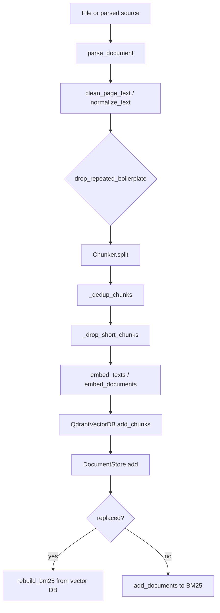

# Ingestion

## Purpose & scope

Turn a file (or a crawled/imported source) into searchable chunks in the tenant's
Qdrant collection, a row in the SQLite document registry, and an in-memory BM25
index.

The entry points are:

- `RAGPipeline.ingest_document()` / `ingest_parsed_documents()` in
  `src/rag_pipeline.py` — used by the API upload route and the bulk CLI.
- `src/ingestion/processor.py` — directory bulk-ingest CLI.
- `src/ingestion/sources/web.py` and `src/ingestion/sources/cloud.py` — crawler and
  S3-compatible import helpers. They produce page `Document`s but are **not**
  exposed by any API route in this repo.

Parsing, chunking, embedding and vector-store writes are all in this module. The
retrieval-side query path lives in `src/retrieval/`.

## Sources & formats

`parse_document()` in `src/ingestion/parsers/__init__.py` dispatches on the file
extension. `config/settings.py` is the single source of truth for accepted
extensions (`SUPPORTED_EXTENSIONS`, `IMAGE_EXTENSIONS`).

| Format | Extensions | Parser | Page model |
|---|---|---|---|
| PDF | `.pdf` | `parsers/pdf.py` | One document per PDF page; hard cap `MAX_PDF_PAGES = 100` |
| Plain text / Markdown | `.txt`, `.md` | `parsers/text.py` | Blank-line sections packed into pseudo-pages of ~`TEXT_PAGE_TARGET_CHARS = 2000` chars |
| HTML | `.html`, `.htm` | `parsers/html.py` | Whole readable body is one page |
| Word | `.docx` | `parsers/docx.py` | Headings start a new pseudo-page; tables rendered row-per-record |
| CSV | `.csv` | `parsers/tables.py` | Header row + `TABLE_ROWS_PER_PAGE = 50` data rows per pseudo-page |
| Excel | `.xlsx` | `parsers/tables.py` | One page series per sheet; page numbers continue across sheets; merged cells filled |
| PowerPoint | `.pptx` | `parsers/slides.py` | One page per non-empty slide (tables and speaker notes included) |
| Images | `.png`, `.jpg`, `.jpeg`, `.webp`, `.bmp`, `.tif`, `.tiff` | `parsers/image.py` | EXIF-transposed, grayscale, upscaled to `OCR_DPI`, OCR; one page |

Non-PDF formats have no physical pages. Logical units (heading sections, slide
number, sheet row block) become `page_number`, so a citation such as "Page 3"
means slide 3 or the third row block.

`src/ingestion/sources/web.py` implements a same-domain breadth-first crawl
(robots.txt, politeness delay, `WEB_MAX_PAGES`) that returns **one** multi-page
document whose `document_id` is `web_<sha1(normalized start URL)[:12]>`. Every
URL is checked against private/loopback/link-local addresses before fetching.

`src/ingestion/sources/cloud.py` lists and downloads S3-compatible objects whose
extension is supported; `collect_supported_objects()` returns `(bytes, filename)`
pairs ready for `ingest_parsed_documents()`.

## Pipeline diagram



`ingest_parsed_documents()` is the shared path for file uploads, web crawls and
cloud imports. `ingest_document()` only parses a file, computes a content hash
from the file bytes and delegates.

## Parsing/OCR/chunking strategy

### PDF extraction order

`parse_pdf()` in `parsers/pdf.py` tries engines per page in this order:

1. `pymupdf` plain text (default primary, `ANEXUS_PDF_TEXT_ENGINE`).
2. `pymupdf4llm` layout-aware Markdown — only when the plain text is shorter than
   `MIN_TEXT_LENGTH_FOR_OCR = 100` chars and the optional package is installed.
3. `pdfplumber` table extraction — only when `ANEXUS_PDF_TABLE_EXTRACTION` is
   `on`, or `auto` (default) and `_looks_tabular()` says the page is table-like.
4. OCR — Tesseract, with RapidOCR as fallback (`parsers/ocr.py`).

A page is accepted by an engine only when `has_sufficient_text()` is true and
`looks_like_gibberish()` is false (alphanumeric ratio below
`ANEXUS_OCR_GIBBERISH_MIN_ALNUM_RATIO = 0.5` is treated as noise). Each page is
tagged with `extractor` and, for OCR, `ocr_engine`.

Markdown artifacts from `pymupdf4llm` are stripped only for that extractor when
`ANEXUS_STRIP_MARKDOWN=auto`; `true`/`false` force the behaviour.

### Text normalization

`parsers/common.normalize_text()` runs on every page:

- Unicode NFKC (ligatures, full-width forms, NBSP).
- Removes soft hyphens, zero-width joiners/spaces and control characters.
- Optional de-hyphenation of words split across a line break
  (`ANEXUS_NORMALIZE_DEHYPHENATE`, default on).
- Trims lines, collapses spaces/tabs, caps consecutive blank lines.

`clean_page_text()` also records `raw_chars` and `clean_chars` in page metadata.
A page keeping less than `ANEXUS_MIN_PAGE_CONTENT_RATIO = 0.15` of its source is
counted as over-cleaned and logged; it is never dropped for that reason.

### Boilerplate removal

`drop_repeated_boilerplate()` runs before chunking when
`ANEXUS_BOILERPLATE_REMOVAL` is `auto`/`true`/`on`/`1`:

- only documents with at least `ANEXUS_BOILERPLATE_MIN_PAGES = 3` pages;
- a line must occur on at least `ANEXUS_BOILERPLATE_MIN_PAGE_FRACTION = 0.6` of
  pages and be at least `ANEXUS_BOILERPLATE_MIN_LINE_CHARS = 12` chars;
- lines containing money amounts or a `:`/`|` label are protected;
- a page is reverted if removal would leave less than
  `max(MIN_CHUNK_CHARS, MIN_PAGE_CONTENT_RATIO * page_len)`.

### Chunking

`src/ingestion/chunker.py` is a self-contained recursive splitter (it deliberately
does not import `langchain_text_splitters`).

- Defaults: `ANEXUS_CHUNK_SIZE = 400` chars, `ANEXUS_CHUNK_OVERLAP = 80`.
- Separators: `["\n\n", "\n", ". ", ", ", " ", ""]`; oversized pieces recurse.
- `ANEXUS_CHUNK_TOKEN_AWARE=1` measures with the embedder tokenizer
  (`embedder.token_length`) and uses `CHUNK_MAX_TOKENS = 500`,
  `CHUNK_TARGET_TOKENS = 384`, `CHUNK_OVERLAP_TOKENS = 64`.
- `ANEXUS_CHUNK_SENTENCE_AWARE=1` packs whole sentences.
- Chunk id is `<document_id>_p<page>_c<n>`; page metadata is preserved.

Exact-duplicate chunks inside one batch are dropped by a normalized SHA-256
digest. Noise-only chunks (no alphanumeric character) are always dropped;
`ANEXUS_MIN_CHUNK_CHARS` (default `0`, disabled) optionally drops short chunks.

## Embedding & storage

`src/services/retrieval/embedding.py` resolves one embedder per process:

- Primary: Gemini `models/gemini-embedding-2-preview`, `GEMINI_EMBEDDING_DIM = 3072`.
- Fallback: local `sentence-transformers` model
  (`ANEXUS_FALLBACK_EMBEDDING_MODEL`, default `all-mpnet-base-v2`, 768-dim).
- `ANEXUS_EMBEDDING_PROVIDER` = `auto` (probe Gemini, fall back), `gemini`
  (require it), or `local` (skip the probe).
- Vectors are L2-normalized. Batches are `ANEXUS_EMBEDDING_BATCH_SIZE = 50`.
- Gemini calls retry on 429/quota up to `ANEXUS_EMBEDDING_MAX_RETRIES = 4` with
  exponential backoff capped at 30 s.

`QdrantVectorDB` (`src/ingestion/qdrant_vectordb.py`) is the only vector backend:

- One collection per tenant: `<COLLECTION_NAME>__<user_id>`
  (`src/auth/tenancy.py`). The base name is `anexus_rag_collection`.
- Cosine distance. The dimension is inferred from the first write, or fixed by
  `ANEXUS_QDRANT_VECTOR_DIM`; a mismatch raises `EmbeddingDimensionMismatch`.
- Point ids are `uuid5(NAMESPACE_URL, "https://anexus.local/qdrant/chunk", chunk_id)`,
  so re-ingesting a chunk overwrites it.
- Upserts are batched by `ANEXUS_QDRANT_ADD_BATCH_SIZE = 256`; full reads scroll
  in pages of `ANEXUS_QDRANT_GET_BATCH_SIZE = 1000`.
- A payload index is created on `metadata.document_id` (best effort).

BM25 (`rank_bm25.BM25Plus`) is in-memory in `HybridRetriever`. Appending a new
document extends it with only that document's chunks; a replace, delete or reset
rebuilds it from the vector store.

## Stored record schema

### Qdrant point

```json
{
  "text": "<chunk text>",
  "metadata": {
    "document_id": "loan_app_01_true.docx",
    "filename": "loan_app_01_true.docx",
    "page_number": 3,
    "source": "loan_app_01_true.docx",
    "ocr_used": false,
    "chunk_id": "loan_app_01_true.docx_p3_c2",
    "doc_type": "docx",
    "extractor": "pymupdf",
    "ocr_engine": "tesseract",
    "raw_chars": 1800,
    "clean_chars": 1700,
    "doc_title": "...",
    "doc_author": "...",
    "doc_created": "..."
  }
}
```

`QdrantVectorDB._to_document()` also writes the cosine score back as
`metadata["similarity"]` on search results. Metadata values are coerced to JSON
scalars/lists by `_clean_metadata()`.

### SQLite `documents` table

`src/ingestion/document_store.py` owns this table in the tenant's
`data/users/<user_id>/app.sqlite3`:

| Column | Meaning |
|---|---|
| `id` | Full filename (stem + extension) |
| `filename` | User-facing filename |
| `pages`, `chunks`, `vectors` | Counts from the last ingest |
| `duration_s` | Ingest duration |
| `content_hash` | SHA-256 of file bytes (or normalized pages for non-file sources) |
| `storage_path` | Stored original file, if retained |
| `storage_managed` | `1` when the app owns the file and may delete it |
| `created_at` | UTC ISO-8601 timestamp |

The registry is the source of truth for the Library; Qdrant is the source of
truth for chunks. `restore_documents()` reconciles them at startup and drops
registry rows whose chunks no longer exist.

## Idempotency, retries, failure handling

- **Idempotent chunks:** deterministic `chunk_id` + UUIDv5 point id. Re-ingesting
  the same document overwrites its previous chunks instead of duplicating them.
- **Legacy ids:** registry rows with a stem-only id from an older build are
  matched by `filename` and removed before the new id is written.
- **Content dedup:** `content_hash` is checked by
  `DocumentStore.find_by_content_hash()`. With `ANEXUS_DEDUP_ACTION=skip`
  (default) a duplicate raises `DuplicateDocumentError`; with `replace` the older
  document is removed first.
- **Dimension changes:** `EmbeddingDimensionMismatch` is raised, never silently
  mixed. Reset with `python -m scripts.reset_vector_store --all-users --yes` and
  re-ingest.
- **Embedding retries:** Gemini 429/quota retries with exponential backoff; other
  errors surface immediately.
- **No usable text:** `parse_document()` returning no pages, or no chunks after
  dedup/short-drop, raises `ValueError`.
- **Partial failure:** Qdrant write happens before the registry row. The API
  upload route removes the document and the stored source file if source retention
  fails after ingestion.
- **Bulk CLI:** per-file failures are counted (`ok`, `skipped`, `failed`) and do
  not abort the run; `DuplicateDocumentError` counts as skipped.
- **Over-cleaning:** reported via `pages_overcleaned` and a warning, never used to
  drop a page.

## Config & env vars

Defined in `config/settings.py` unless noted.

| Variable | Default | Effect |
|---|---|---|
| `ANEXUS_CHUNK_SIZE` | `400` | Recursive chunk size (chars) |
| `ANEXUS_CHUNK_OVERLAP` | `80` | Chunk overlap (chars) |
| `ANEXUS_CHUNK_TOKEN_AWARE` | `0` | Size chunks with the embedder tokenizer |
| `ANEXUS_CHUNK_MAX_TOKENS` | `500` | Token cap when token-aware |
| `ANEXUS_CHUNK_TARGET_TOKENS` | `384` | Soft token fill target |
| `ANEXUS_CHUNK_OVERLAP_TOKENS` | `64` | Token overlap |
| `ANEXUS_CHUNK_SENTENCE_AWARE` | `0` | Pack whole sentences |
| `ANEXUS_CHUNK_CONTEXT_HEADER` | `off` | `meta` embeds a `title · page N` prefix; stored text stays clean |
| `ANEXUS_PDF_TEXT_ENGINE` | `pymupdf` | `pymupdf`, `pymupdf4llm` or `tables` |
| `ANEXUS_OCR_ENGINE` | `tesseract` | `tesseract` or `rapidocr` |
| `ANEXUS_PDF_TABLE_EXTRACTION` | `auto` | `auto`, `on`, `off` |
| `ANEXUS_OCR_GIBBERISH_MIN_ALNUM_RATIO` | `0.5` | Gibberish threshold |
| `ANEXUS_NORMALIZE_DEHYPHENATE` | `1` | Rejoin hyphenated line breaks |
| `ANEXUS_STRIP_MARKDOWN` | `auto` | Strip Markdown artifacts |
| `ANEXUS_BOILERPLATE_REMOVAL` | `auto` | `auto`, `off` |
| `ANEXUS_BOILERPLATE_MIN_PAGES` | `3` | Minimum pages to check |
| `ANEXUS_BOILERPLATE_MIN_PAGE_FRACTION` | `0.6` | Page fraction for a repeated line |
| `ANEXUS_BOILERPLATE_MIN_LINE_CHARS` | `12` | Minimum repeated-line length |
| `ANEXUS_MIN_PAGE_CONTENT_RATIO` | `0.15` | Over-cleaning flag threshold |
| `ANEXUS_MIN_CHUNK_CHARS` | `0` | Optional short-chunk floor (disabled) |
| `ANEXUS_DEDUP_ACTION` | `skip` | `skip` or `replace` |
| `ANEXUS_EXTRACT_EMBEDDED_METADATA` | `1` | Attach PDF/DOCX/XLSX/PPTX properties |
| `ANEXUS_EMBEDDING_PROVIDER` | `auto` | `auto`, `gemini`, `local` |
| `GEMINI_API_KEY` | unset | Enables Gemini embeddings |
| `GEMINI_EMBEDDING_MODEL` | `models/gemini-embedding-2-preview` | Gemini model |
| `GEMINI_EMBEDDING_DIM` | `3072` | Gemini dimension |
| `ANEXUS_FALLBACK_EMBEDDING_MODEL` | `all-mpnet-base-v2` | Local model |
| `ANEXUS_FALLBACK_EMBEDDING_DIM` | `768` | Local dimension hint |
| `ANEXUS_EMBEDDING_BATCH_SIZE` | `50` | Embed batch size |
| `ANEXUS_EMBEDDING_MAX_RETRIES` | `4` | Gemini rate-limit retries |
| `ANEXUS_QDRANT_URL` | unset | Qdrant endpoint (`QDRANT_URL`/`QDRANT_CLUSTER_ENDPOINT` accepted) |
| `ANEXUS_QDRANT_API_KEY` | unset | Qdrant key |
| `ANEXUS_QDRANT_COLLECTION` | `anexus_rag_collection` | Base collection name |
| `ANEXUS_QDRANT_VECTOR_DIM` | `0` | Fixed dimension; `0` infers |
| `ANEXUS_QDRANT_ADD_BATCH_SIZE` | `256` | Upsert batch |
| `ANEXUS_QDRANT_GET_BATCH_SIZE` | `1000` | Scroll page size |
| `ANEXUS_MAX_UPLOAD_MB` | `50` | API upload cap (`src/api/config.py`) |

`MIN_TEXT_LENGTH_FOR_OCR = 100`, `OCR_DPI = 300`, `MAX_PDF_PAGES = 100`,
`TEXT_PAGE_TARGET_CHARS = 2000`, `TABLE_ROWS_PER_PAGE = 50`,
`MAX_TABLE_ROWS = 20000` and `SUPPORTED_EXTENSIONS` are constants in
`config/settings.py`, not env vars. Note the separate legacy
`MAX_UPLOAD_MB = 20` in `config/settings.py`; the API enforces the
`ANEXUS_MAX_UPLOAD_MB` value above.

## How to run

Bulk-ingest a directory into one tenant's corpus:

```bash
python -m src.ingestion.processor Dataset --user-id <user_id>
python -m src.ingestion.processor Dataset --user-id <user_id> --wipe
python -m src.ingestion.processor Dataset --user-id <user_id> --json
```

`--wipe` resets that tenant's vectors and registry first. `--json` also writes
`processed_data/<source_type>/<filename>.json`. The CLI configures
observability as `anexus-bulk-ingest`.

Upload through the API (the same pipeline):

```bash
curl -H "X-User-Id: <user_id>" \
     -F "file=@Synthetic_Mortgage_Loan_File_TEST_01.pdf" \
     http://localhost:8000/api/documents
```

Reset the vector store after an embedding-model change:

```bash
python -m scripts.reset_vector_store --all-users --yes
```

Relevant tests: `tests/test_parser.py`, `tests/test_parsers_multiformat.py`,
`tests/test_ocr.py`, `tests/test_chunker.py`, `tests/test_vectordb.py`,
`tests/test_document_store.py`, `tests/test_source_files.py`,
`tests/test_cloud_source.py`, `tests/test_web_source.py`.

## Known limits

- PDF parsing is capped at 100 pages; larger PDFs are rejected.
- Tables are capped at `MAX_TABLE_ROWS = 20000` rendered rows per sheet/table.
- OCR quality depends on the scan; Tesseract is the baseline and RapidOCR is the
  fallback. No OCR engine at all raises `RuntimeError`.
- The web crawler and S3 importer are library code; no API route exposes them.
- Qdrant is the only vector backend. Changing the embedding provider/model
  requires a collection reset and full re-ingest.
- BM25 is process-local and rebuilt from Qdrant on first retrieval after restart;
  it is not shared across workers.
- `parse_document()` is synchronous; the API runs ingestion in a thread pool.
- Metadata extraction is best-effort and silently skipped when properties are
  absent or the optional library cannot read them.