# Observability

## Purpose

One place configures tracing, logging and optional HTTP/system instrumentation for
the API, bulk ingestion and the evaluation harness, with a privacy contract that
keeps document text, queries, prompts, answers, credentials and raw user ids out
of traces.

The module is `src/observability.py`. It wraps Logfire/OpenTelemetry and degrades
to no-ops when Logfire is not installed or `configure_observability()` was never
called, so unit tests and offline development send nothing.

Agent-specific LangSmith tracing is configured separately in `src/config.py`.

## Signals (logs, traces, metrics)

### Traces

Spans are created through `src.observability.span()` (or `logfire.span()` directly
in `src/agents/nodes/`). HTTP spans come from `logfire.instrument_requests()` and
`logfire.instrument_httpx()` with headers and bodies explicitly disabled.

### Logs

- Application modules use the stdlib `logging` module.
- `configure_observability()` installs `_RedactingLogfireHandler` on the root
  logger. It copies each record, replaces `record.msg` with `redact_text(...)`, and
  forwards it to Logfire. Other handlers still see the original message.
- `src.observability.info/warning/error/exception/debug` are thin Logfire event
  helpers; they do nothing when observability is off.
- The logging bridge level defaults to `LOGFIRE_LOG_LEVEL = WARNING`, so INFO logs
  do not automatically become traces.

### Metrics

There are no custom metric instruments in the codebase. The only metrics signal is
opt-in:

- `LOGFIRE_SYSTEM_METRICS=1` calls `logfire.instrument_system_metrics()`.
- HTTP/httpx instrumentation creates spans; it does not define an application
  metric catalog.

In-process counters exist but are not exported as metrics:
`ResponseCache.stats()` (`src/cache.py`) and `QuotaTracker.status()`
(`src/routing/quota_tracker.py`). Quota state is persisted to
`config/quota_state.json`, not to a metrics backend.

## Architecture diagram

```mermaid
flowchart LR
    API[src.api.main] --> CFG[configure_observability]
    CLI[src.ingestion.processor] --> CFG
    EVAL[evaluation.run_eval] --> CFG
    CFG --> LC[logfire.configure]
    LC --> SP[span / info / warning / error]
    LC --> HTTP[requests + httpx instrumentation]
    LC --> MET[system metrics optional]
    LC --> LOG[_RedactingLogfireHandler]
    LOG --> RED[redact_text]
    LC --> EXP{token and send?}
    EXP -- yes --> CLOUD[Logfire cloud]
    EXP -- no --> LOCAL[no export / local console]
    AGENTS[src/agents/nodes] -->|direct logfire| LC
    CFG2[src/config.py] --> ENV[LANGCHAIN_* env] --> SMITH[LangSmith]
```

`configure_observability()` is called before pipeline imports in:

- `src/api/main.py` — `service_name="anexus-api"`;
- `src/ingestion/processor.py` — `service_name="anexus-bulk-ingest"`;
- `evaluation/run_eval.py` — `service_name="anexus-eval"`.

`src/main.py` (the legacy single-tenant app) calls `logfire.configure()` directly
and is not covered by the shared helper. The LangGraph nodes import `logfire`
directly and therefore rely on whichever process configured it.

## Tracing & span conventions

### Services

| Service name | Set by |
|---|---|
| `anexus-api` | `src/api/main.py` |
| `anexus-bulk-ingest` | `src/ingestion/processor.py` |
| `anexus-eval` | `evaluation/run_eval.py` |
| `anexus` | Default in `config/settings.py` (`LOGFIRE_SERVICE_NAME`) |

### Span names

| Area | Span names |
|---|---|
| Parsers | `ingestion.parsers.parse_document`, `ingestion.parsers.html.parse_html`, `ingestion.parsers.image.parse_image`, `ingestion.parsers.ocr.ocr_image_with_engine`, `ingestion.parsers.tables.parse_csv`, `ingestion.parsers.tables.parse_xlsx` |
| Common parsing | `ingestion.parsers.common.drop_repeated_boilerplate`, `ingestion.parsers.common.group_sections`, `ingestion.parsers.common.render_table_lines` |
| Chunking | `ingestion.chunker.split` |
| Qdrant | `ingestion.qdrant.add_chunks`, `ingestion.qdrant.search`, `ingestion.qdrant.delete_document`, `ingestion.qdrant.document_ids`, `ingestion.qdrant.get_all_documents`, `ingestion.qdrant.reset` |
| Registry | `ingestion.document_store.add`, `ingestion.document_store.set_storage_path`, `ingestion.document_store.list`, `ingestion.document_store.get`, `ingestion.document_store.find_by_content_hash`, `ingestion.document_store.remove`, `ingestion.document_store.clear` |
| Sources | `ingestion.sources.web.fetch_page`, `ingestion.sources.web.crawl_documents`, `ingestion.sources.cloud.list_objects`, `ingestion.sources.cloud.get_object_bytes`, `ingestion.sources.cloud.collect_supported_objects` |
| Embedding | `embed.query`, `embed.texts`, `embed.batch` |
| RAG | `rag.embed_chunks`, `rag.retrieve`, `rag.rerank`, `rag.generate`, `rag.generate_stream` |
| LLM | `llm.generate`, `llm.generate_messages` |
| Agent | `agent.qdrant.search`, `services.ranking_service.rerank_documents`, `🧠 Planner Decision`, `🔍 Knowledge Retrieval`, `⚖️ Semantic Reranking`, `✍️ LLM Synthesis` |
| CLI | `processor.ingest_file` |

### Attribute conventions

- Counts and sizes: `page_count`, `chunk_count`, `chunks`, `dim`, `k`,
  `candidate_count`, `top_k`, `text_count`, `batch_size`.
- Provider/model names: `provider`, `model`, `dimension`, `provider_order`.
- Status/behavior: `intent`, `mode`, `document_scoped`, `query_variants`,
  `filtered`, `context_header`.
- Identifiers: `hash_id(...)`, never the raw value.
- Durations are recorded by Logfire itself; the code also measures explicit
  durations in a few places (for example `ranking_service.rerank_documents`).

`span()` is a context manager that yields `None` when observability is off.
`bind()` attaches attributes to spans created inside the block.

## Metrics catalog

No application-defined metrics exist. The catalog is therefore:

| Signal | Source | Notes |
|---|---|---|
| System metrics | `logfire.instrument_system_metrics()` | Only when `LOGFIRE_SYSTEM_METRICS=1` |
| HTTP spans | `logfire.instrument_requests()`, `logfire.instrument_httpx()` | Headers and bodies are not captured |
| Cache counters | `ResponseCache.stats()` | In-process only; not exported |
| Quota state | `QuotaTracker.status()` | In-process + `config/quota_state.json` |

TODO: confirm whether any Logfire-side dashboards or metric rollups are defined
outside this repository.

## Dashboards & alerts

No dashboard definitions, alert rules or SLO configuration are present in the
repository. Logfire cloud (when configured) is the only external surface; any
dashboards or alerts would be created there.

TODO: confirm the Logfire project, dashboard layout and alert policy used by the
deployment.

## PII/redaction

The privacy contract in `src/observability.py`:

- Never attach document text, queries, prompts, answers, file contents,
  credentials or raw user identifiers to a span or log event.
- Prefer counts, durations, model/provider names, status codes, scores and
  `hash_id(...)` values.
- Disable HTTP body/header capture.

Controls:

| Control | Implementation |
|---|---|
| Stable pseudonymous ids | `hash_id(value, length=12)` — SHA-256 prefix |
| Log message redaction | `redact_text()` — email, secret prefixes (`sk`, `gsk`, `AIza`, `pylf`, `hf`, `xox*`), `Bearer ...`, runs of 9+ digits; caps at 500 chars |
| Attribute scrubbing | `logfire.ScrubbingOptions(extra_patterns=_SCRUB_PATTERNS)` |
| HTTP capture | `capture_headers=False`, `capture_request_body=False`, `capture_response_body=False` |
| Argument capture | `inspect_arguments=False` |
| Test runs | Export is hard-disabled when `PYTEST_CURRENT_TEST` is set or `pytest` is in `sys.modules`; `tests/conftest.py` also sets `LOGFIRE_SEND_TO_LOGFIRE=0` |

Current gap: the LangGraph nodes log raw text derived from the user's question:

- `src/agents/nodes/planner.py:39` logs the planner decision (the search query);
- `src/agents/nodes/retriever.py:15` logs `f"Searching Qdrant for: {query}"`.

These bypass `hash_id()` and the redacting handler is the only thing standing
between them and a trace. Treat agent traces as containing user-derived text until
this is changed.

## Config & env vars

Defined in `config/settings.py` unless noted.

| Variable | Default | Effect |
|---|---|---|
| `LOGFIRE_TOKEN` | unset | Enables Logfire cloud export |
| `LOGFIRE_SEND_TO_LOGFIRE` | unset | `1`/`0` forces export on/off; a token is still required |
| `LOGFIRE_CONSOLE` | `0` | Log spans to the console (`ConsoleOptions` for logfire >= 3) |
| `LOGFIRE_SERVICE_NAME` | `anexus` | Default service name |
| `LOGFIRE_ENVIRONMENT` | `ANEXUS_ENV` or `development` | Environment tag |
| `LOGFIRE_LOG_LEVEL` | `WARNING` | Level of the stdlib logging bridge |
| `LOGFIRE_SYSTEM_METRICS` | `0` | Enable system metrics |
| `LANGSMITH_API_KEY` | unset | Agent-only LangSmith tracing (`src/config.py`) |
| `LANGSMITH_TRACING` | `true` when key is set | Sets `LANGCHAIN_TRACING_V2` |
| `LANGSMITH_PROJECT` | `rag_scale_test` | LangSmith project |
| `LANGSMITH_ENDPOINT` | `https://api.smith.langchain.com` | LangSmith endpoint |
| `ANEXUS_ENV` | `development` | Used by API settings and the default logfire environment |

`tests/conftest.py` sets `LOGFIRE_SEND_TO_LOGFIRE=0` by default for the test
suite. `configure_observability()` also forces `send_to_logfire=False` when no
token is present.

## Debugging playbook

### No traces appear

1. Confirm `configure_observability()` ran in the process (API, bulk ingest and
   `run_eval` call it; the legacy `src/main.py` uses its own `logfire.configure`).
2. Check `LOGFIRE_TOKEN` is set, or set `LOGFIRE_CONSOLE=1` for local spans.
3. Check `LOGFIRE_SEND_TO_LOGFIRE` is not `0`.
4. Check `LOGFIRE_LOG_LEVEL`; the bridge defaults to `WARNING`.
5. Look for `Logfire configuration failed` in the logs — a bad configuration is
   logged and tracing is disabled.

### Logs are missing

- The stdlib bridge only forwards records at `LOGFIRE_LOG_LEVEL` or above.
- Use `src.observability.info/warning/error` for explicit events.
- A broken log sink is swallowed by `_RedactingLogfireHandler.emit()` so it cannot
  break a request.

### Sensitive data appears in a trace

- Check whether the call site uses `hash_id()` for identifiers.
- Check whether it logs raw text; the agent planner/retriever are known gaps.
- `redact_text()` covers common secrets and long digit runs, but it is not a PII
  scrubber; use `PresidioScrubber` before any provider call.

### Trace volume is too high

- Disable `LOGFIRE_SYSTEM_METRICS`.
- Raise `LOGFIRE_LOG_LEVEL` (for example `ERROR`).
- Remove or sample high-cardinality spans such as per-batch embedding spans.

### LangSmith is not tracing

- LangSmith is configured only by `src/config.py`; importing that module sets
  `LANGCHAIN_TRACING_V2`, `LANGCHAIN_API_KEY`, `LANGCHAIN_PROJECT` and
  `LANGCHAIN_ENDPOINT`.
- Set `LANGSMITH_API_KEY`; tracing defaults to true when the key is present.
- LangSmith is separate from Logfire; both can be active at once.

### Test runs

- Export is disabled by design. If a test needs a local sink, use
  `LOGFIRE_CONSOLE=1`; do not set a real token in CI.