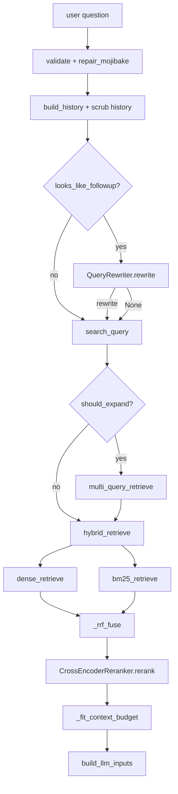

# Retrieval

## Purpose

Fetch the chunks that answer a question, then hand a small, ranked, PII-scrubbed
context to the generator.

The retrieval stack is:

- `HybridRetriever` (`src/retrieval/retriever.py`) — dense Qdrant search + BM25,
  fused with weighted Reciprocal Rank Fusion (RRF).
- `CrossEncoderReranker` (`src/retrieval/reranker.py`) — local cross-encoder
  scoring and top-k truncation.
- `QueryExpander` (`src/retrieval/query_expander.py`) — optional LLM paraphrases,
  each retrieved and RRF-fused with the original query.
- `QueryRewriter` (`src/memory/rewriter.py`) — follow-up resolution before
  retrieval (used by `RAGPipeline._prepare()`).

The orchestration lives in `RAGPipeline._prepare()` in `src/rag_pipeline.py`.
The LangGraph agent uses a separate path (`src/services/retrieval/`) and is
documented in `docs/AGENT.md`.

## Retrieval flow diagram



If retrieval returns nothing and the query was rewritten, `_prepare()` retries
with the raw query. If it still returns nothing, the pipeline returns a
`no_context` `FinalAnswer` without calling the LLM.

## Index & vector store

### Dense channel

`HybridRetriever.dense_retrieve()` calls `embed_query()` from
`src/services/retrieval/embedding.py` and then
`QdrantVectorDB.search(query_embedding, k=self.k, where=...)`.

- `k = BASE_K_RETRIEVAL = 10` per channel.
- Collection: `<COLLECTION_NAME>__<user_id>`, cosine distance.
- `where = {"document_id": document_id}` when a document scope is active.
- `QdrantVectorDB._to_document()` writes the cosine score into
  `metadata["similarity"]`; `RETRIEVAL_MIN_SIMILARITY` can drop hits below it.
- A dense failure is logged and returns `[]`; BM25 still runs.

When a test injects `embedding_model`, `dense_retrieve()` uses the legacy
`model.encode(QUERY_INSTRUCTION + query, normalize_embeddings=True)` path
instead of the provider service. The instruction is BGE-specific and is not
applied to Gemini or `all-mpnet-base-v2`.

### Sparse channel

`bm25_retrieve()` uses `rank_bm25.BM25Plus` over an in-memory tokenized corpus.

- Tokenizer: `_TOKEN_RE = re.compile(r"[^\W_]+(?:[.,][0-9]+)*")` on lowercased
  text. It keeps numbers such as `7.25` and `4,50,000` intact and is
  Unicode-aware.
- Only chunks sharing at least one query token are returned; without this filter
  BM25 returns `k` arbitrary chunks even when nothing matches.
- `document_id` is applied as a post-filter over ranked candidates because BM25
  has no native metadata filter. The corpus idf remains global.
- `_ensure_bm25()` rebuilds the index from `vector_db.get_all_documents()` once
  after a restart if it is empty. `add_documents()` extends it incrementally;
  `rebuild_bm25()` is used after replace/delete/reset.

### Fusion

`_rrf_fuse()` scores each candidate as:

```
score += weight / (RRF_K + rank)
```

- `ANEXUS_DENSE_WEIGHT = 0.5`, `ANEXUS_BM25_WEIGHT = 0.5`, `ANEXUS_RRF_K = 60`.
- Equal weights and `RRF_K = 60` reproduce classic RRF.
- Candidate key is `(document_id, page_number, chunk_id)`, or a SHA-1 of the
  content when `chunk_id` is missing. The same chunk from both channels is fused
  once.
- `hybrid_retrieve()` returns up to `2 * BASE_K_RETRIEVAL = 20` candidates.

`multi_query_retrieve()` de-duplicates variants case-insensitively, runs
`hybrid_retrieve()` for each, RRF-fuses all result lists with weight `1.0`, and
caps the result at `HYBRID_CANDIDATES = 20`.

## Query processing

`RAGPipeline._prepare()` performs, in order:

1. `_validate_query()` — non-empty, max 5000 chars.
2. `repair_mojibake()` on the raw query.
3. `has_document` — requires a registry row and at least one vector.
4. Document-scope validation: an unknown `document_id` returns `no_context`
   instead of leaking a cross-document result.
5. `build_history()` windows the chat history; the summary and every turn are
   scrubbed by `PresidioScrubber` before use.
6. Follow-up rewrite when `looks_like_followup()` is true
   (`<= REWRITE_MAX_WORDS = 6` words, or a marker such as "what about", "the
   second one", "it"). The rewrite is used for retrieval, reranking, routing and
   the prompt question.
7. Query expansion when `should_expand()` is true:
   `ANEXUS_QUERY_EXPANSION_ENABLED=1`, at least
   `ANEXUS_QUERY_EXPANSION_MIN_WORDS = 7` words, and
   `ANEXUS_QUERY_EXPANSION_VARIANTS = 2` paraphrases. The original query is always
   included. Expansion uses `LLM_TEMPERATURE_EXPANSION = 0.3`.
8. Retrieval (single or multi-query).
9. Reranking and context budgeting.

Any rewrite/expansion failure degrades to the original query; the simulated LLM
returns no usable paraphrases.

## Ranking & reranking

`CrossEncoderReranker` (`src/retrieval/reranker.py`):

- Model: `cross-encoder/ms-marco-MiniLM-L-6-v2`, loaded once per process and
  cached by `(model_name, device)`.
- Device: CPU; `RERANK_BATCH_SIZE = 8` to keep the 4 GB RAM budget.
- Scores every `(query, chunk)` pair, sorts descending, keeps `TOP_K_RERANK = 5`.
- `ANEXUS_RERANK_MIN_SCORE` optionally drops chunks below a raw logit. Unset means
  no filtering.
- Empty query or no candidates returns `[]`.

After reranking, `_fit_context_budget()` trims the list to
`ANEXUS_CONTEXT_MAX_CHARS = 6000` characters, always keeping the top chunk. The
same trimmed list feeds both the prompt and the citations, so they cannot diverge.

## Filters & metadata

### Document scope

The client can restrict a question to one ingested document. The scope is applied
to both channels:

- dense: Qdrant `metadata.document_id` filter;
- BM25: candidate post-filter on `metadata["document_id"]`.

Selecting "All documents" removes the scope. Removing the scoped document resets
the selection in the client.

### Metadata used downstream

| Field | Use |
|---|---|
| `document_id` | Scope filter, citation key |
| `filename` | Citation label and display |
| `page_number` | Citation page, dedup key |
| `chunk_id` | Stable chunk identity and RRF key |
| `similarity` | Dense score (cosine) and optional threshold |
| `ocr_used` | Ingest quality stats |

### Optional relevance floors

- `ANEXUS_RETRIEVAL_MIN_SIMILARITY` — minimum cosine similarity for dense hits.
  Hits without a `similarity` field are kept.
- `ANEXUS_RERANK_MIN_SCORE` — minimum cross-encoder logit.

Both are unset by default. If every candidate falls below a floor, the pipeline
returns the safe "no context" answer.

## Latency & cost notes

- First query loads the embedder (Gemini probe, or ~420 MB local model) and the
  ~90 MB cross-encoder; subsequent turns reuse the process cache.
- Dense retrieval is one network call (Gemini) or one local encode; BM25 is local
  and in-memory.
- Multi-query retrieval multiplies dense + BM25 calls by the number of unique
  variants (original + up to 2 paraphrases).
- Follow-up rewrite adds one LLM call; query expansion adds one LLM call. Both are
  skipped for short/simple queries and for the simulated LLM.
- Reranking is local CPU work proportional to `candidates * chunk length`.
- `ANEXUS_CONTEXT_MAX_CHARS` bounds prompt size and therefore generation cost.
- A response-cache hit (`RAGPipeline._read_cached_answer`) skips retrieval,
  reranking and generation entirely.

There is no per-query retrieval cost priced in code; the evaluation harness meters
LLM calls only (`evaluation/cost.py`).

## How to run

Run the retrieval-focused tests:

```bash
python -m pytest -q tests/test_retriever.py tests/test_retriever_multiquery.py \
  tests/test_reranker.py tests/test_query_expander.py tests/test_real_retrieval.py
```

`tests/test_real_retrieval.py` is opt-in:

```bash
$env:ANEXUS_RUN_REAL_TESTS=1
python -m pytest -q tests/test_real_retrieval.py
```

Exercise retrieval end-to-end through the evaluation harness:

```bash
python -m evaluation.run_eval \
  --file Synthetic_Mortgage_Loan_File_TEST_01.pdf \
  --file Synthetic_Mortgage_Loan_File_TEST_02.pdf
```

Build a pipeline directly (used by the API, CLI and eval):

```python
from src.pipeline_factory import build_user_pipeline

bundle = build_user_pipeline("<user_id>")
bundle.pipeline.answer_query("What is the loan amount?")
```

## Known limits

- BM25 is process-local; multiple workers each build their own index and do not
  share it.
- Qdrant is the only dense backend. There is no fallback vector store.
- Reranking is CPU-only and loads a cross-encoder; the first query pays the model
  load.
- No learned sparse retrieval (SPLADE, etc.); BM25 is lexical only.
- The dense query instruction is applied only for local BGE models, not for
  Gemini or `all-mpnet-base-v2`.
- Multi-query expansion is skipped below 7 words and when the simulated LLM is
  active; it cannot help very short lookups.
- The relevance floors are off by default and are not tuned automatically; enabling
  them without an eval run can turn valid answers into "no context".
- Document scoping relies on `document_id` metadata; chunks written before the
  field existed cannot be scoped reliably.